# AGENTS.md — Workflow y Coordinación de Agentes

Este documento define cómo los agentes de IA deben trabajar en este repositorio:
flujo de trabajo, habilidades disponibles, puntos de intervención humana y reglas
de operación.

## Flujo de Trabajo Estándar

Todo cambio en el repositorio sigue este flujo secuencial:

```mermaid
flowchart TD
    I["1. ISSUE"]
    IN["2. INVESTIGACIÓN"]
    ADR{"3. ADR<br>necesario?"}
    A["Crear ADR"]
    P["4. PLAN"]
    BR{"¿Cambio en<br>código?"}
    B["5. CREAR RAMA<br>feature/bugfix/refactor"]
    IMP["6. IMPLEMENTACIÓN"]
    R["7. REVIEW"]
    C["8. COMMIT + MERGE"]

    G1{"⛔ GATE 1<br>Humano revisa"}
    G1b{"⛔ GATE 1b<br>Humano revisa ADR"}
    G2{"⛔ GATE 2<br>Humano revisa"}
    G3{"⛔ GATE 3<br>Humano revisa"}

    I --> IN
    IN --> G1
    G1 -->|Rechaza| IN
    G1 -->|Aprueba| ADR

    ADR -->|No| P
    ADR -->|Sí| A
    A --> G1b
    G1b -->|Rechaza| A
    G1b -->|Aprueba| P

    P --> G2
    G2 -->|Rechaza| P
    G2 -->|Aprueba| BR

    BR -->|Sí, código| B
    BR -->|No, docs/otros| IMP

    B --> IMP
    IMP --> R
    R --> G3
    G3 -->|Rechaza| IMP
    G3 -->|Aprueba| C

    style I fill:#e3f2fd,stroke:#1565c0,color:#000
    style IN fill:#fff3e0,stroke:#e65100,color:#000
    style A fill:#fff3e0,stroke:#e65100,color:#000
    style P fill:#fff3e0,stroke:#e65100,color:#000
    style B fill:#d1c4e9,stroke:#4527a0,color:#000
    style IMP fill:#e8f5e9,stroke:#2e7d32,color:#000
    style R fill:#fce4ec,stroke:#c62828,color:#000
    style C fill:#e8f5e9,stroke:#2e7d32,color:#000
    style ADR fill:#e3f2fd,stroke:#1565c0,color:#000
    style BR fill:#e3f2fd,stroke:#1565c0,color:#000

    style G1 fill:#ffcdd2,stroke:#b71c1c,color:#000
    style G1b fill:#ffcdd2,stroke:#b71c1c,color:#000
    style G2 fill:#ffcdd2,stroke:#b71c1c,color:#000
    style G3 fill:#ffcdd2,stroke:#b71c1c,color:#000
```



### Paso 1: Issue
- Se reporta un problema o se solicita una feature
- Se documenta en `docs/agents/issues/` siguiendo la plantilla `ISSUE-TEMPLATE.md`
- El agente planificador principal analiza y decide el siguiente paso

### Paso 2: Investigación
- Se analiza la causa raíz, se exploran las partes del código implicadas
- Se documenta en `docs/agents/research/`
- **⛔ GATE: Humano revisa** → Si la investigación no es correcta o está incompleta,
  se itera antes de continuar

### Paso 3: ADR (solo si procede)
- Si el cambio implica una decisión arquitectónica relevante
  (cambio de tecnología, modificación estructural, nueva dependencia)
- Se documenta en `docs/agents/adr/` siguiendo la plantilla `ADR-TEMPLATE.md`
- **⛔ GATE: Humano revisa** → El ADR debe ser aprobado antes de crear el plan

### Paso 4: Plan
- Se crea un plan detallado de implementación con tareas concretas
- Se documenta en `docs/agents/plans/` siguiendo la plantilla `PLAN-TEMPLATE.md`
- **⛔ GATE: Humano revisa** → El plan debe ser aprobado antes de implementar

### Paso 5: Crear Rama (si aplica)
- Si el plan implica cambios en **código fuente** (Java, SQL, frontend, etc.):
  - Se crea una rama desde `develop` siguiendo la convención GitFlow
  - `feature/<nombre-descriptivo>` para nuevas funcionalidades
  - `bugfix/<nombre-descriptivo>` para correcciones
  - `refactor/<nombre-descriptivo>` para refactorizaciones
- Si el plan solo implica **documentación, issues, u otros cambios menores**:
  - Se trabaja directamente sobre `develop`

### Paso 6: Implementación
- Los agentes especializados ejecutan las tareas del plan
- Cada agente se selecciona según el tipo de trabajo (ver tabla de agentes)
- El agente planificador coordina y supervisa

### Paso 7: Review (humano)
- **⛔ GATE 3: Humano revisa la implementación**
- Se revisa `git diff`, se verifica que no hay secretos, que los tests pasan,
  que el código sigue las convenciones
- **Solo tras la aprobación humana** se pasa al paso 8

### Paso 8: Commit + Merge (agente, tras aprobación)
- El agente ejecuta `git commit` con un mensaje que sigue el **formato híbrido**:
  `tipo(ámbito): [ISSUE-NNN] descripción`
- Combina **conventional commits** (tipo y ámbito) con la convención del proyecto
  (referencia JIRA `[ISSUE-NNN]`)
- Ejemplos:
  - `feat(ecommerce): [ISSUE-520] añadir seleccion de convocatoria en compras`
  - `fix(plataforma-gestion): [ISSUE-680] corregir seleccion multiple en promociones pack`
  - `docs(wiki): [ISSUE-XXX] actualizar documentacion de arquitectura`
  - `refactor(api): [ISSUE-XXX] simplificar logica de validacion de cursos`
- Si se trabajó en una rama GitFlow, se fusiona a `develop` tras el commit
- **Nunca hacer push a remotos**. Solo el humano ejecuta `git push`

## Agentes Disponibles

| Agente | Capa | Responsabilidad | Cuándo triggerearlo |
|--------|------|-----------------|---------------------|
| `task-decomposer` | planners | Descomponer tareas complejas en subtareas manejables | Cuando un plan es demasiado vago o una tarea necesita dividirse |
| `repo-researcher` | planners | Explorar el codebase, entender estructuras y dependencias | Antes de investigar un bug, al llegar a una parte desconocida del código |
| `backend-engineer` | engineering | Implementar lógica de backend, APIs, persistencia | Cuando el plan implica código Java, Netty, Hibernate, SQL |
| `frontend-engineer` | engineering | Interfaz de usuario | Cuando el plan implica UI web (GWT/GXT, HTML, JS) |
| `refactor-engineer` | engineering | Refactorizar código existente | Cuando se necesita reorganizar código sin cambiar comportamiento |
| `code-reviewer` | quality | Validar calidad del código, arquitectura y buenas prácticas | Después de una implementación, antes del commit humano |
| `debugger` | quality | Investigar errores runtime, excepciones, fallos | Cuando hay bugs concretos con logs o stacks conocidos |
| `test-engineer` | quality | Crear y mantener tests automatizados | Cuando el plan incluye testing unitario, de integración o funcional |
| `performance-optimizer` | specialists | Optimizar rendimiento (CPU, memoria, I/O) | Cuando hay cuellos de botella identificados en producción |
| `security-auditor` | specialists | Analizar seguridad del código y dependencias | En cambios que afecten autenticación, datos sensibles o exposición de red |
| `docs-writer` | specialists | Redactar y mantener documentación técnica | Cuando se crean o actualizan docs, wiki, especificaciones |

## Skills Disponibles

Las skills son instrucciones especializadas que los agentes pueden cargar para
realizar tareas específicas con mayor precisión.

| Skill | Descripción | Cuándo triggerearla |
|-------|-------------|---------------------|
| **bash-defensive-patterns** | Técnicas defensivas de Bash para scripts de producción, CI/CD y utilidades del sistema | Al escribir scripts shell, pipelines CI/CD, o utilidades que requieran tolerancia a fallos |
| **bitacora** | Gestión de bitácoras de trabajo con frontmatter estandarizado | Al completar un bloque de trabajo que se quiera documentar, o al consultar la bitácora existente |
| **conventional-commit** | Generación de mensajes de commit con el formato híbrido del proyecto (`tipo(ámbito): [ISSUE-NNN] descripción`) | Para preparar mensajes de commit estandarizados (**Uso exclusivo bajo petición de commit del humano**) |
| **find-skills** | Descubrimiento e instalación de nuevas skills | Cuando se busca una funcionalidad que podría existir como skill instalable |
| **jira** | Gestión de issues en Jira: buscar, crear, actualizar, transicionar, comentar, registrar tiempo, subtareas, sprints | Cuando se menciona una tarea, ticket o issue de Jira, o se pide cualquier operación sobre ellos |
| **mermaid-diagrams** | Creación de diagramas software con sintaxis Mermaid | Al modelar arquitectura, flujos, diagramas de clases, secuencia, ERD, C4, o cualquier visualización técnica |

## Puntos de Intervención Humana (Human-in-the-Loop)

Estos son los puntos obligatorios donde un humano debe revisar y aprobar antes
de continuar:

### ⛔ GATE 1: Investigación → Plan
**Cuándo**: Después de completar `docs/agents/research/`
**Quién revisa**: Humano
**Qué revisa**:
- ¿El análisis de causa raíz es correcto?
- ¿Se exploraron todas las alternativas relevantes?
- ¿La investigación está completa y documentada?

**Si hay ADR**: El ADR debe revisarse también aquí (GATE 1b)

### ⛔ GATE 2: Plan → Implementación
**Cuándo**: Después de crear `docs/agents/plans/`
**Quién revisa**: Humano
**Qué revisa**:
- ¿Las tareas están bien desglosadas?
- ¿El enfoque técnico es correcto?
- ¿Se consideraron edge cases y riesgos?
- ¿La estimación es realista?

### ⛔ GATE 3: Implementación → Commit
**Cuándo**: Después de que los agentes implementen los cambios
**Quién revisa**: Humano (revisa), Agente (commitea tras aprobación)
**Qué revisa el humano**:
- `git diff` para verificar los cambios exactos
- ¿El código sigue las convenciones del proyecto?
- ¿No hay secretos, credenciales o datos sensibles?
- ¿Los tests pasan?
**Qué hace el agente tras aprobación**:
- Ejecuta `git add` de los archivos verificados
- Ejecuta `git commit` con mensaje conventional commit
- **Nunca hace push**

## Reglas de Operación

### Sobre Commits y Push
- ✅ Los agentes **sí** ejecutan `git commit`, **pero solo tras aprobación explícita
  del humano** (GATE 3)
- ✅ Los commits usan el **formato híbrido**:
  `tipo(ámbito): [ISSUE-NNN] descripción`
  Que combina **conventional commits** (tipo y ámbito) con la convención del proyecto
  (referencia JIRA `[ISSUE-NNN]`)
- ❌ Los agentes **nunca** ejecutan `git push`, `git push --force` ni ninguna
  operación que envíe cambios a remotos
- ✅ Solo el humano ejecuta `git push`

### Sobre Gestión de Ramas (GitFlow)
- La rama principal de desarrollo es `develop`
- **Nunca** se trabaja directamente en `develop` para cambios de código fuente
- Las únicas excepciones que se permiten directamente en `develop` son:
  - Creación/modificación de issues en `docs/agents/issues/`
  - Modificaciones de documentación (README, wiki, etc.)
  - Otros cambios menores que no afecten a código fuente
- Para cualquier cambio en **código fuente**, se crea una rama desde `develop`:
  - `feature/<descripcion>` — Nuevas funcionalidades
  - `bugfix/<descripcion>` — Corrección de errores
  - `refactor/<descripcion>` — Refactorizaciones
  - Opcionalmente se puede incluir el código del issue de Jira (ej: `feature/ISSUE-123-filtro-temporal`)
- Tras la aprobación humana (GATE 3), el agente commitea y fusiona a `develop`
- El merge a `develop` se hace localmente; el humano se encarga del push posterior
- `main` o `master` se reserva para releases; solo el humano fusiona `develop` → `main`

### Sobre Gestión de Dependencias
- ❌ **Los agentes nunca deben editar las secciones `dependencies`, `devDependencies`
  o `peerDependencies` de ningún `package.json` directamente**
- ✅ Siempre deben usar la CLI de pnpm con `--filter` para añadir, actualizar o
  eliminar dependencias. Ejemplos:
  - `pnpm add zod --filter ./apps/core-api` — dependencia de producción
  - `pnpm add -D typescript --filter ./packages/config` — dependencia de desarrollo
  - `pnpm add openai@^6.41.0 --filter ./apps/ai-agent` — versión concreta
  - `pnpm remove jest --filter ./packages/core-sdk` — eliminar dependencia
- Esto asegura que:
  - Las versiones se resuelven correctamente según el registro
  - El `pnpm-lock.yaml` se actualiza de forma consistente
  - Los peer dependencies se validan automáticamente
  - No se introducen versiones obsoletas o incompatibles

### Sobre el Formato de Commits (Conventional Commits + JIRA)

El proyecto usa un formato híbrido que combina **conventional commits** con la
referencia **JIRA `[ISSUE-NNN]`**:

```
tipo(ámbito): [ISSUE-NNN] descripción
```

#### Tipos permitidos

| Tipo | Uso | Ejemplo |
|------|-----|---------|
| `feat` | Nueva funcionalidad | `feat(ecommerce): [ISSUE-520] añadir seleccion de convocatoria en compras` |
| `fix` | Corrección de bug | `fix(plataforma-gestion): [ISSUE-680] corregir seleccion multiple en promociones pack` |
| `docs` | Documentación | `docs(wiki): [ISSUE-XXX] actualizar documentacion de arquitectura` |
| `refactor` | Refactorización | `refactor(api): [ISSUE-XXX] simplificar logica de validacion de cursos` |
| `perf` | Mejora de rendimiento | `perf(api): [ISSUE-XXX] optimizar consulta de ingresos` |
| `test` | Tests | `test(ecommerce): [ISSUE-XXX] anadir tests de pago redsys` |
| `style` | Formato/estilos | `style(web): [ISSUE-XXX] ajustar espaciado en datatable` |
| `chore` | Mantenimiento | `chore(deps): [ISSUE-XXX] actualizar dependencias maven` |
| `ci` | CI/CD | `ci(api): [ISSUE-XXX] configurar sonarqube` |
| `security` | Seguridad | `security(auth): [ISSUE-XXX] parchear vulnerabilidad JWT` |

#### Ámbitos (scopes) recomendados

| Ámbito | Componente |
|--------|-----------|
| `ecommerce` | Portal público (catálogo, carrito, pago) |
| `plataforma-gestion` | Panel de administración |
| `api` | Backend API general |
| `web` | Frontend Angular general |
| `auth` | Autenticación y autorización |
| `moodle` | Integración con Moodle LMS |
| `redsys` | Pasarela de pago Redsys |
| `pdf` | Generación de documentos PDF |
| `email` | Notificaciones por email |
| `bbdd` | Base de datos y migraciones Flyway |
| `deps` | Dependencias del proyecto |
| `wiki` | Documentación wiki |
| `docs` | Documentación general |

### Sobre la Documentación
- Toda la documentación se escribe en **español (España)**
- Los issues, investigaciones, ADRs y planes se almacenan en `docs/`
- Las features se especifican en Gherkin (**español**, `# language: es`)
- La wiki usa archivos planos `.md` en `docs/wiki/` (formato GitLab Wiki)

### Sobre la Coordinación
- El agente planificador (software-architect) es el coordinador por defecto
- Los agentes especializados reportan al planificador
- Ante ambigüedad, el planificador pregunta al humano antes de continuar
- Si un agente encuentra un problema imprevisto, detiene la ejecución y reporta

---

*Última actualización: 2026-06-18*
