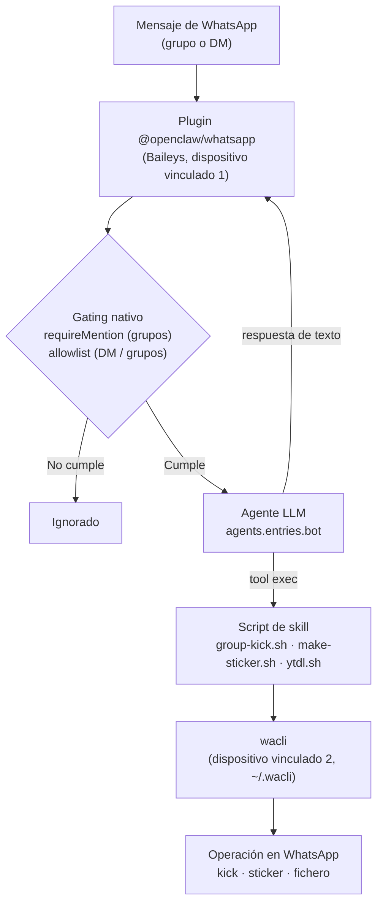

# openclaw-whatsapp-bot

Bot de WhatsApp autoalojado, construido como **capa de configuración y
despliegue** sobre la imagen oficial de OpenClaw. No es una aplicación propia:
es una imagen Docker derivada (`ffmpeg`, `jq`, `yt-dlp`, `wacli`), un
`docker-compose.yml`, la configuración `conf/openclaw.json` y tres skills
propias (`group-admin`, `sticker`, `ytdl`).

## Qué es

Un bot de WhatsApp que:

- responde en **grupos solo bajo mención** y en **DMs solo a una allowlist**
  (el número del propietario);
- **expulsa (kick)** a participantes de un grupo, **verificando que el emisor es
  admin** y que el propio bot es admin (verificación *fail-closed*);
- crea y envía **stickers** (imagen o vídeo corto → webp 512×512) con `ffmpeg`;
- descarga **vídeo/audio de YouTube** con `yt-dlp` + `ffmpeg` y lo envía al chat;
- usa un **proveedor LLM parametrizado** por `.env` (por defecto Ollama Cloud,
  con Ollama local como reserva).

Toda la lógica de canal, gating y agente la aporta la imagen oficial de
OpenClaw; este repositorio sólo añade la imagen derivada, la configuración y las
skills que cubren lo que el plugin de WhatsApp no expone de forma nativa.

## Requisitos previos

- **Docker** y **Docker Compose** (plugin `docker compose` v2).
- **Un número de teléfono dedicado al bot**: un número **nuevo**, no tu número
  personal. Es un requisito **duro**: vincular este bot puede conllevar avisos o
  baneos de WhatsApp (ver *Limitaciones y riesgos*), por lo que nunca debe usarse
  un número personal.
- Un **teléfono con WhatsApp** instalado y operativo en ese número: se usará
  para escanear los **dos** códigos QR del proceso de alta.

## Arquitectura

### Una sola cuenta, dos dispositivos vinculados

El bot es **UNA cuenta de WhatsApp (un número) con DOS dispositivos
vinculados** (*Linked Devices* de WhatsApp Multi-Device), no dos cuentas:

1. **Dispositivo vinculado #1 — sesión Baileys del plugin.** El plugin oficial
   `@openclaw/whatsapp` (sobre Baileys `7.0.0-rc14`) y su store viven en
   `~/.openclaw` (volumen `openclaw-state`). Es el que **recibe y envía** los
   mensajes del bot.
2. **Dispositivo vinculado #2 — sesión de `wacli`.** `wacli` (CLI en Go sobre
   `whatsmeow`) tiene su propio store en `~/.wacli` (volumen `wacli-store`). Es
   el que ejecuta las operaciones de grupo (kick, consulta de participantes) y
   el envío de stickers.

Ambos dispositivos pertenecen a la **misma cuenta**, comparten la misma
pertenencia a grupos y los mismos permisos de administrador.

**¿Por qué dos dispositivos y no uno?** Porque el plugin del canal **no puede
reutilizarse desde fuera**: el Gateway es el dueño del socket de WhatsApp y no
existe API pública ni IPC para que un proceso externo use la sesión Baileys del
plugin (el issue upstream
[#144695](https://github.com/openclaw/openclaw/issues/144695) —kick y acciones de
participante nativas— se cerró como *not planned*; el envío de stickers sigue
abierto en [#7476](https://github.com/openclaw/openclaw/issues/7476)). La vía
documentada —y la que usa el propio OpenClaw en otros componentes— es emparejar
un **segundo dispositivo vinculado** con su propia librería (`wacli` sobre
`whatsmeow`) y que el agente lo invoque desde una skill mediante la tool `exec`.
El detalle técnico completo está en `ADR-001` y `RESEARCH-002`.

### Flujo de un mensaje



- La **configuración** (`conf/openclaw.json`) fija `requireMention` para grupos,
  `dmPolicy: allowlist` + `allowFrom` para DMs y `groupPolicy: allowlist` +
  `groupAllowFrom` para grupos.
- El **agente** (entrada `bot` en `agents.entries`) resuelve el modelo primario
  `${LLM_MODEL}` con reserva local `ollama/qwen3:8b`.
- Las **skills** enseñan al agente cuándo y cómo invocar cada script; los scripts
  llaman a `wacli` para las operaciones que el plugin no expone.

## Instalación y puesta en marcha

1. **Prepara el fichero de entorno** y rellena los valores reales (como mínimo
   `OPENCLAW_GATEWAY_TOKEN`, ver *Variables de entorno*):

   ```bash
   cp .env.example .env
   # edita .env con tus valores
   ```

2. **Construye y levanta el gateway**:

   ```bash
   docker compose up -d --build
   ```

3. **Comprueba el estado** (opcional pero recomendado):

   ```bash
   docker compose --profile cli run --rm openclaw-cli openclaw doctor
   ```

4. **Instala el plugin del canal WhatsApp** (el que recibe y envía los
   mensajes):

   ```bash
   docker compose --profile cli run --rm openclaw-cli openclaw plugins install @openclaw/whatsapp
   ```

5. **Vincula los DOS dispositivos** (login por QR). Los **dos** QR se escanean
   desde **el mismo teléfono del bot** (el número dedicado). El primer QR crea
   la sesión del plugin (la que responde), el segundo la sesión de `wacli` (la
   que hace kick, stickers y ficheros):

   ```bash
   # QR 1 — sesión Baileys del plugin (recibe y responde)
   docker compose --profile cli run --rm openclaw-cli openclaw channels login --channel whatsapp

   # QR 2 — sesión de wacli (kick, stickers, ficheros)
   docker compose --profile cli run --rm openclaw-cli wacli auth
   ```

6. **Avisa al bot en un grupo mencionándolo** (o escríbele por DM desde el
   número del propietario) para comprobar que responde.

El servicio `openclaw-cli` es un contenedor *one-shot* con el perfil `cli`
(comparte imagen, volúmenes y montajes del gateway): sirve para todas las
operaciones manuales anteriores.

### Alternativa: Ollama local como reserva

El `docker-compose.yml` incluye un servicio `ollama` **desactivado por defecto**
(perfil `local-llm`). Para usar el LLM local como reserva:

```bash
docker compose --profile local-llm up -d ollama
docker compose exec ollama ollama pull qwen3:8b   # ~5 GB de descarga
```

## Variables de entorno

Todas las variables viven en `.env` (nunca se commitea; ver `.gitignore`). La
plantilla comentada con valores por defecto es `.env.example`.

- **Requerida para arrancar**: `OPENCLAW_GATEWAY_TOKEN`. Sin ella, el gateway
  **no arranca** (la resolución del secreto de `gateway.auth.token` falla y el
  arranque se bloquea).

| Variable | Grupo | ¿Requerida para arrancar? | Descripción |
| --- | --- | --- | --- |
| `OPENCLAW_GATEWAY_TOKEN` | Gateway | **Sí** | Token compartido del gateway (`gateway.auth.token`). Generar con `openssl rand -hex 32`. |
| `OWNER_PHONE` | Propietario / gating | No | Número del propietario en E.164 (`+34…`). Se usa en `allowFrom` (DM) y `commands.ownerAllowFrom`. |
| `GROUP_ALLOW_FROM` | Gating de grupos | No | JID del grupo permitido (`…@g.us`) en `groupAllowFrom`. |
| `OLLAMA_API_KEY` | LLM | No | Clave de Ollama Cloud (plan Free, sin tarjeta). El plugin `ollama-cloud` la lee del entorno; sin ella el proveedor queda inactivo. |
| `LLM_MODEL` | LLM | No | Modelo primario del agente (`ollama-cloud/…`). |
| `OLLAMA_BASE_URL` | LLM | No | Endpoint de Ollama local (reserva). Por defecto `http://ollama:11434`. Mientras no se defina, se emite el aviso `missing env var OLLAMA_BASE_URL`. |
| `LLM_API_KEY` | LLM (legacy) | No | Clave genérica inyectada en `OPENAI_API_KEY`/`ANTHROPIC_API_KEY`. Con la estrategia Ollama se deja sin usar. |
| `LLM_PROVIDER` | LLM (informativo) | No | Sólo informativo; la referencia activa es `LLM_MODEL`. |
| `MEDIA_MAX_MB` | Media | No | Límite de media en MB que comprueban las skills antes de enviar (por defecto 50). |
| `MEDIA_FORCE_DOCUMENT` | Media | No | Si es `true`, los ficheros que superan el límite se entregan como documento. |
| `WHATSAPP_HISTORY_LIMIT` | Gating de grupos | No | Historial de grupo inyectado al agente. Queda **sin uso** en `conf/openclaw.json` (se fija el literal 50). |
| `SKILLS_MOUNT_MODE` | Despliegue | No | Modo del montaje `./skills` → `/home/node/.openclaw/skills` (`rw` por defecto; `ro` en producción). |
| `BOT_JID` | Identidad del bot | No | JID del propio bot (`numero@s.whatsapp.net`). **A confirmar** en la verificación empírica (T-07). |
| `TZ` | Despliegue | No | Zona horaria del contenedor (por ejemplo `Europe/Madrid`). |

> Nota: `mediaMaxMb` y `historyLimit` de `conf/openclaw.json` son enteros en el
> esquema `2026.10.3` y **no admiten sustitución `${VAR}`**; por eso la config
> fija el literal `50` y las variables `MEDIA_MAX_MB`/`WHATSAPP_HISTORY_LIMIT`
> las consumen otros componentes (las skills) o quedan sin uso.

## Skills incluidas

Las tres skills viven en `skills/` y se montan en el contenedor en
`/home/node/.openclaw/skills`:

| Skill | Qué hace | Requisitos (bins) | Estado |
| --- | --- | --- | --- |
| `group-admin` | Expulsa (kick) a un participante vía `wacli`, con verificación **fail-closed**: emisor admin + bot admin + objetivo participante. Si falta cualquier condición, **no expulsa**. | `wacli`, `jq` | Kick **inertado por diseño** hasta confirmar los roles admin y fijar `BOT_JID` (tarea T-07). |
| `sticker` | Convierte imagen/vídeo corto en sticker webp 512×512 (estático ≤100 KiB, animado ≤500 KiB) con `ffmpeg` y lo envía con `wacli send sticker`. | `ffmpeg`, `wacli` | Operativo (pendiente de prueba E2E). |
| `ytdl` | Descarga vídeo o audio de YouTube con `yt-dlp` + `ffmpeg` (allowlist de dominios, `--no-playlist`, chequeo de tamaño) y envía el resultado. | `yt-dlp`, `ffmpeg`, `wacli` | Operativo (pendiente de prueba E2E). |

## Limitaciones y riesgos

- **Radio de impacto (blast radius) de un baneo — riesgo principal.** El bot es
  **una sola cuenta con dos dispositivos vinculados**: si WhatsApp banea o
  bloquea **la cuenta**, caen **a la vez** los dos dispositivos (la sesión
  Baileys del plugin **y** `wacli`). No son dos sistemas independientes: es un
  único radio de impacto que deja al bot completo inoperativo. Este riesgo está
  documentado en `ADR-001` (whatsmeow
  [#810](https://github.com/tulir/whatsmeow/issues/810) reporta avisos y baneos
  incluso con bajo volumen, afectando a whatsmeow **y Baileys**; probabilidad
  **no cuantificada**). Consecuencia operativa para el seguimiento:
  - hay que **vigilar las dos sesiones** (plugin y `wacli`);
  - una **caída de `wacli`** degrada **en silencio**: el bot sigue respondiendo,
    pero las skills que dependen de él (kick, stickers, ficheros) fallan, y el
    kick falla *cerrado* (no expulsa);
  - una **caída de la sesión Baileys** deja al bot **totalmente mudo**.
  - Mitigación: número dedicado, moderación del volumen de envíos (evitar
    ráfagas), y plan de retirada (deshabilitar la skill `group-admin` si
    aparecen avisos).
- **El kick aún no está activo.** La verificación empírica de los roles admin en
  la salida de `wacli` (tarea **T-07** del `PLAN-001`) sigue pendiente, igual que
  `BOT_JID`. Hasta entonces el script sale con código 21 y **no expulsa a nadie**:
  es el comportamiento esperado (*fail-closed*).
- **Fragilidad de la cuota del LLM gratuito.** La estrategia usa Ollama Cloud en
  plan Free con *starter credits* cuyo importe y lista de modelos **no están
  publicados**, y con **1 petición concurrente**; al agotarse la cuota (o ante un
  `402`), el bot puede quedarse sin respuesta. El respaldo es el Ollama local
  (perfil `local-llm`), que mantiene el bot vivo. Ver `RESEARCH-004`.
- **Límite de media.** `mediaMaxMb` está fijado en **50 MB** en la config, pero el
  límite duro real de WhatsApp puede ser **menor** (no confirmado; verificación
  pendiente en T-16). Las skills comprueban el tamaño antes de enviar y, si se
  supera, avisan o entregan como documento según `MEDIA_FORCE_DOCUMENT`.

## Solución de problemas

- **Ver el estado de los servicios**:

  ```bash
  docker compose ps
  docker compose logs -f openclaw-gateway
  ```

- **Diagnóstico general**: `docker compose --profile cli run --rm openclaw-cli
  openclaw doctor`.

- **Dónde vive cada estado** (volúmenes):
  - `openclaw-state` → `/home/node/.openclaw`: estado del Gateway y **sesión
    Baileys** del plugin (dispositivo vinculado #1).
  - `wacli-store` → `/home/node/.wacli` (**`WACLI_STORE_DIR`**): store de la
    **sesión de `wacli`** (dispositivo vinculado #2) y sus *locks*.
  - `ollama-models`: modelos del Ollama local (si se usa el perfil `local-llm`).

- **Las dos sesiones deben seguir autenticadas**:
  - si **`wacli`** se desconecta o desvincula, **el bot sigue respondiendo**
    pero **fallan** el kick, los stickers y las descargas;
  - si se **desvincula la sesión Baileys** (dispositivo #1), el bot **no recibe
    ni envía nada** (silencio total).
  Para reautenticar, repite los dos logins por QR de *Instalación y puesta en
  marcha*.

- **Avisos de WhatsApp** ("tu cuenta puede estar en riesgo"): si aparecen,
  reduce el volumen de envíos y valora deshabilitar la skill `group-admin`.

## Estado del proyecto

- **Hecho**: imagen Docker derivada y `docker-compose.yml`; `conf/openclaw.json`
  (gating, media, LLM); las tres skills (`group-admin`, `sticker`, `ytdl`);
  estrategia de LLM investigada y documentada (`RESEARCH-003`, `RESEARCH-004`).
- **Pendiente**: la verificación empírica del canal y de los roles admin
  (`PLAN-001` T-06/T-07) y las pruebas de extremo a extremo (T-14…T-17), **bloqueadas
  a la espera de disponer de un número de teléfono dedicado**. Hasta que se
  completen, el **kick permanece inertado** y los comandos de este README no se
  han validado todavía contra un despliegue real.

## Documentación

Los artefactos de diseño y seguimiento viven en `docs/agents/`:

- Issue: `docs/agents/issues/ISSUE-001-bot-whatsapp-openclaw.md`
- Investigación: `docs/agents/research/RESEARCH-001…004`
- Decisión de arquitectura: `docs/agents/adr/ADR-001-mecanismos-capacidades-no-nativas.md`
- Plan de implementación: `docs/agents/plans/PLAN-001-bot-whatsapp-openclaw.md`
