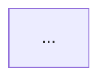

## Contexto

### El Problema

Descripción del problema o feature.

### Diagnóstico

Hallazgos de la investigación.

## Causas Raíz

| # | Causa | Archivo | Líneas | Impacto |
|---|-------|---------|--------|---------|
| 🔴 1 | ... | ... | ... | **Alta** |
| 🟡 2 | ... | ... | ... | **Media** |

## Solución Propuesta

### Cambio 1: [Archivo — línea]
...

### Cambio 2: [Archivo — línea]
...

## Archivos Afectados

| # | Archivo | Cambio | Prioridad |
|---|---------|--------|-----------|
| 1 | ... | ... | 🔴 Crítico |
| 2 | ... | ... | 🟡 Preventivo |

## Diagrama

## Checklist de Implementación

### Cambios críticos
- [ ] ...

### Cambios preventivos
- [ ] ...

### Verificación
- [ ] ...

## Tiempo Estimado

| Fase | Duración |
|------|----------|
| ... | ... |
| **Total** | **...** |

## Riesgos Identificados

| ID | Riesgo | Probabilidad | Impacto | Mitigación |
|----|--------|--------------|---------|------------|
| R1 | ... | ... | ... | ... |
